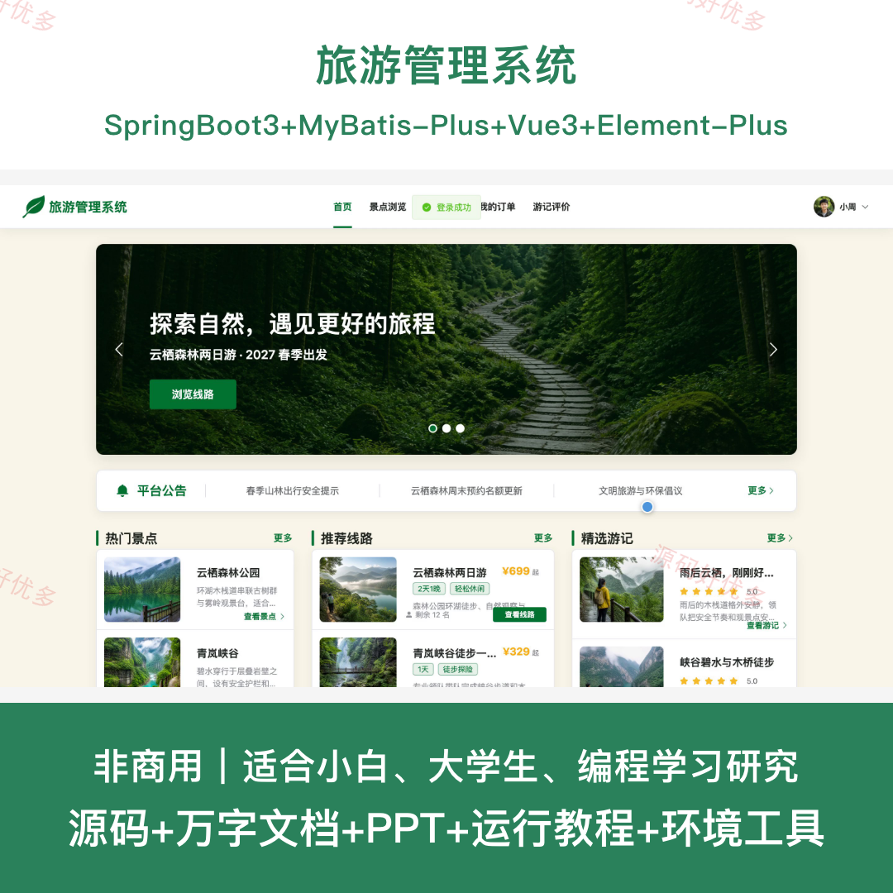
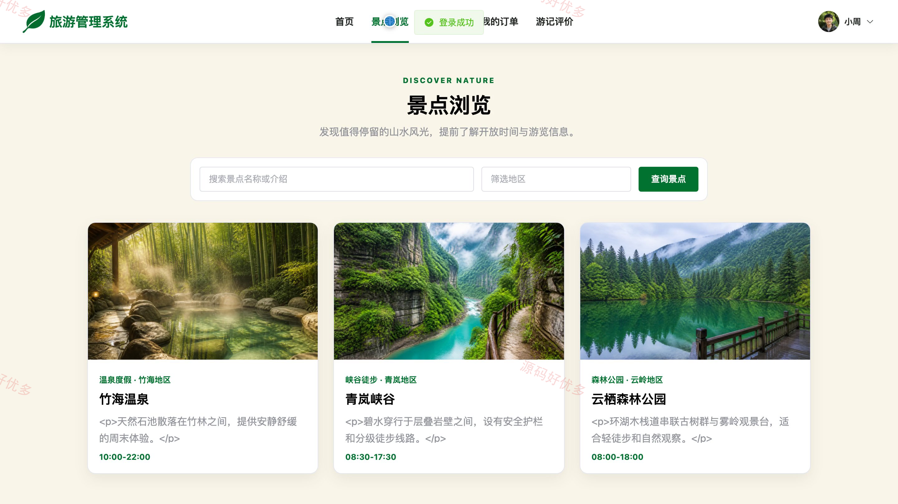
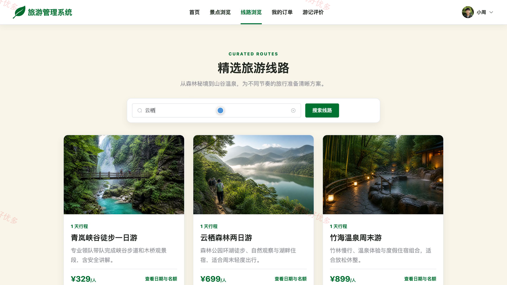
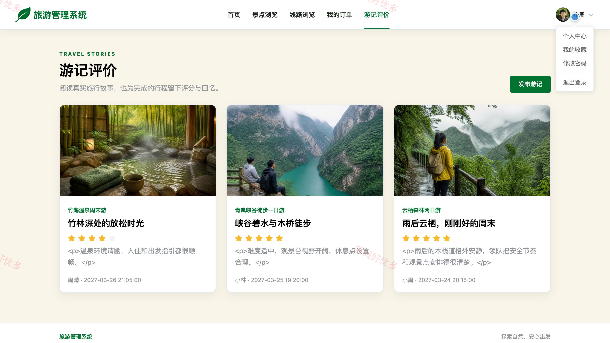
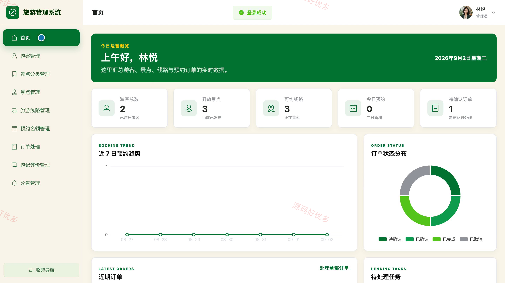
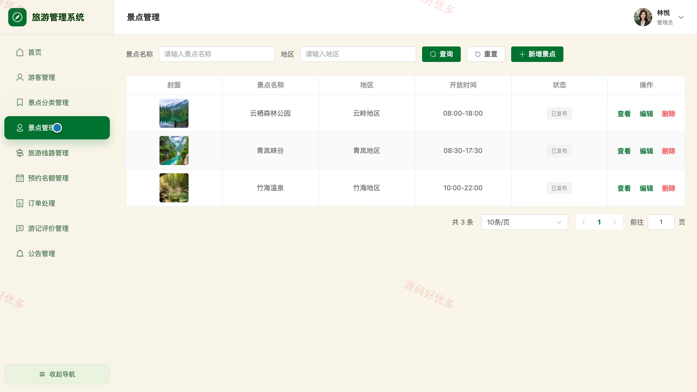
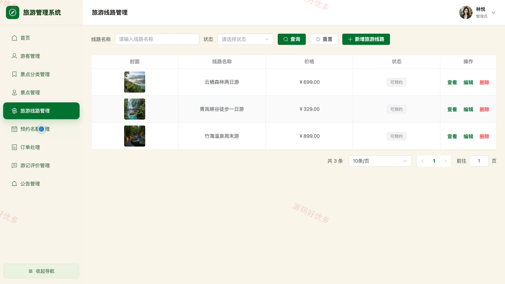
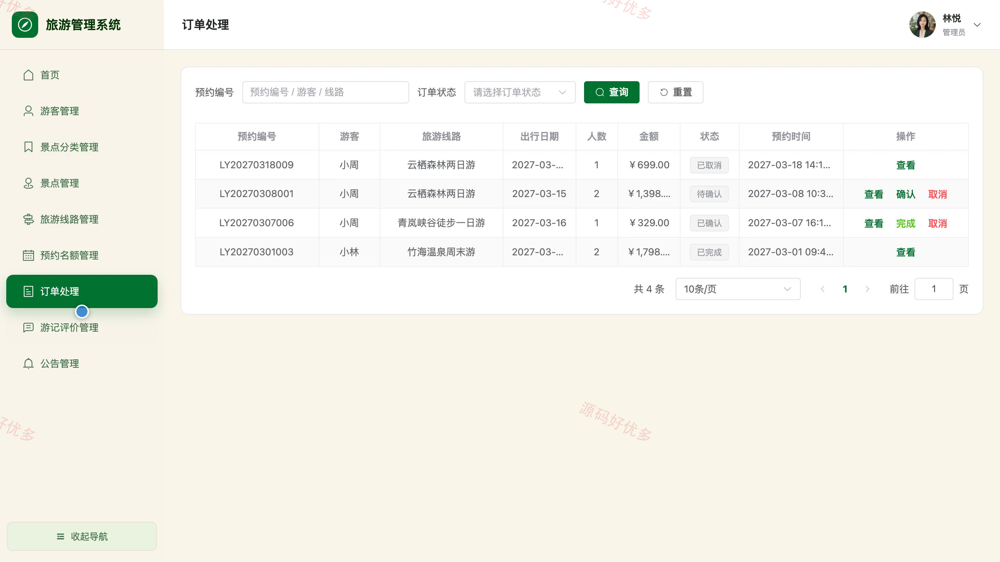

# bs114A
bs114A旅游管理系统
## 源码问题查看主页咨询

### 一、关键词
旅游管理、景点导览、旅游线路、出行预约、游记分享

### 二、作品包含
源码+数据库+万字设计文档+PPT+全套环境和工具资源+本地部署教程

### 三、项目技术
前端技术： Html、Css、Js、Vue3.4、Element-Plus
后端技术：Java、SpringBoot3.2.0、MyBatis-Plus

### 四、运行环境要求
开发工具：IDEA/eclipse + VSCODE

数据库：MySQL5.7+（共15张表）

数据库管理工具：Navicat10以上版本

环境配置软件： JDK17 + Maven3.6+

前端Nodejs：16+

浏览器：谷歌浏览器

### 五、项目介绍
项目编号：bs114A

旅游管理系统面向游客和管理员，提供景点与线路浏览、收藏、预约订单、游记评价等游客服务，并支持旅游资源、预约名额、订单、评价和公告的后台管理。

角色：游客、管理员

游客功能：注册登录、旅游首页、景点筛选与详情浏览、旅游线路与可预约日期浏览、景点和线路收藏、在线预约与订单取消、游记评价、个人资料与密码维护。

管理员功能：数据看板、游客管理、景点分类管理、景点管理、旅游线路管理、预约名额管理、订单处理、游记评价与公告管理。

### 六、运行截图

